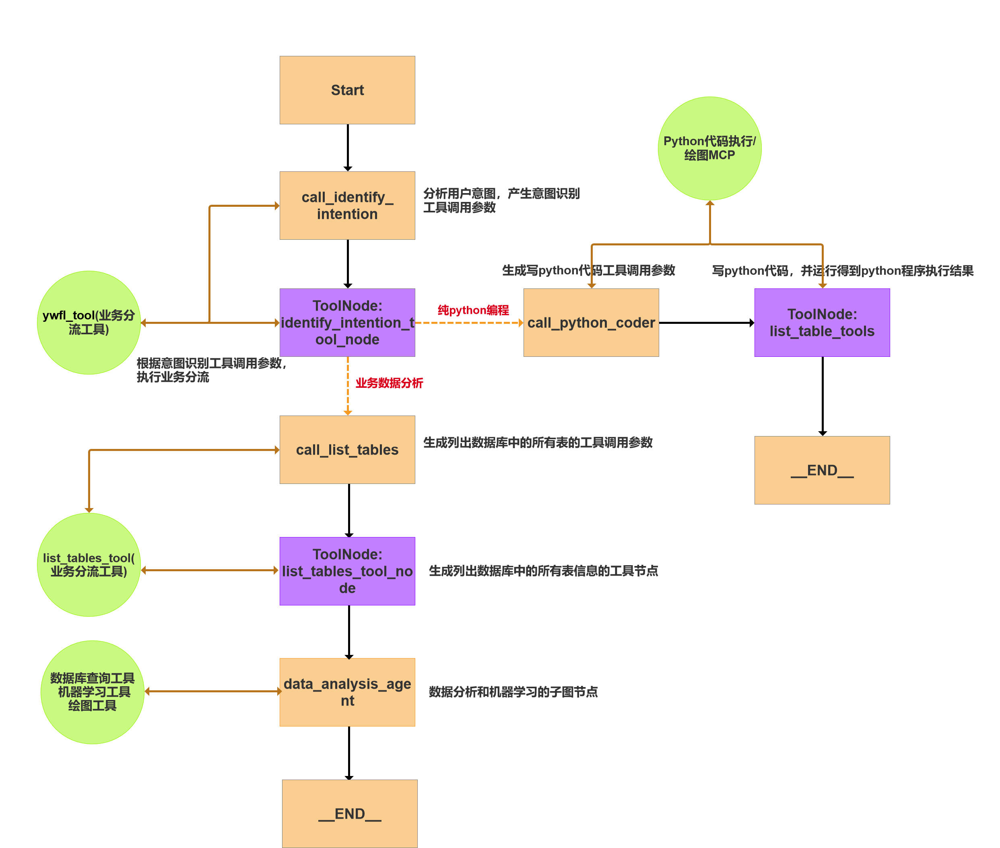
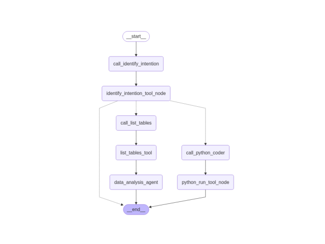

# ChatBI 数据分析智能助手

基于 **LangGraph 多智能体编排 + MCP（Model Context Protocol）工具服务** 的对话式数据分析助手。用自然语言提问，自动完成取数、统计建模、图表绘制与日常问答。



## 解决什么问题

电商场景下数理统计、报表分析和数据建模需求碎片化、时效性高、复用性低，传统「产品经理 → 数据分析师 → 机器学习工程师 → 交付」链路太长。本项目把这条链路压缩成一次对话：

- **科学计算**：`2^100 是多少？`
- **业务取数**：`冰箱的客单价是多少？`
- **数据建模**：`肥皂下个月销量帮我预测一下`
- **可视化**：`根据肥皂近 12 个月的销量画一张折线图`
- **代码生成**：`写一个冒泡排序的 Java 代码`
- **日常交流**：闲聊类问题直接由大模型回答

## 架构



```
用户 ──▶ chat_ui.html (单页对话界面)
            │ HTTP POST /chatbi_service
            ▼
      FastAPI chat_api.py :9008
            │
            ▼
   LangGraph 主流程图 (chatbi_graph)
   ├─ 业务分流节点  ──▶ ywfl_mcp :9005        判断问题属于哪类任务
   ├─ 取数节点      ──▶ search_db_mcp :9004   自然语言 → SQL → 查询 PostgreSQL
   ├─ 计算/绘图节点 ──▶ python_chart_mcp :9002 自然语言 → Python → 解释器执行
   └─ 建模节点      ──▶ machine_learning_mcp :9003  对取数结果做算法建模
            │
            ▼
       PostgreSQL :5432  (sales_chat 库)
```

关键设计：

- **MCP 服务按业务域拆分**，每个服务独立进程、独立端口，通过 MCP 协议（Streamable HTTP）暴露工具，LangGraph 节点按当前流程位置决定调用哪个工具。
- **业务分流（ywfl）先行**：先判断任务类型再路由，避免让所有工具都参与候选而导致误调用。
- **NL2SQL + NL2Python 双通道**：结构化问题走 SQL，需要计算或绘图的问题走 Python 代码生成 + 解释器执行。
- **数据库字段全部写中文注释**（由 `setup_db.py` 完成），让 LLM 能正确理解表与字段含义，这是 NL2SQL 准确率的前提。

## 目录结构

```
.
├── langGraph_agent/
│   ├── setup_db.py                    # 建表 + 导入 Excel + 写入中文字段注释
│   ├── project_data/                  # 示例数据（4 个 Excel，共 9 张表）
│   ├── output_plots/                  # 绘图输出
│   └── smart_data_analysis_assistant/
│       ├── .env.example               # 环境变量模板（复制为 .env 后填写）
│       ├── chat_ui.html               # 前端对话界面
│       ├── start_all.ps1              # 一键启动：4 个 MCP + FastAPI + 端口自检
│       ├── stop_all.ps1               # 一键停止
│       ├── 启动.txt                    # 启动说明（含 PostgreSQL 启停）
│       ├── chatbi_graph/              # LangGraph 主流程
│       │   ├── build_graph.py         # 图结构定义
│       │   ├── chat_api.py            # FastAPI 服务（/chatbi_service, :9008）
│       │   ├── execute_graph.py       # 图执行入口
│       │   ├── my_llm.py              # 模型初始化
│       │   ├── my_state.py            # 状态定义
│       │   ├── tools_node.py          # 工具节点
│       │   └── post_test.py           # 接口测试脚本
│       └── mcp_server/                # 4 个 MCP 服务
│           ├── statistic_db_mcp_tools.py   # :9004  取数（NL2SQL）
│           ├── python_chart_mcp.py         # :9002  计算与绘图（NL2Python）
│           ├── machine_learning_mcp.py     # :9003  机器学习建模
│           ├── ywfl_mcp.py                 # :9005  业务分流
│           └── multi_mcp_client.py         # MCP 客户端聚合
├── requirements.txt
└── 整体架构.png / langGraph图.jpg
```

## 快速开始

### 1. 环境准备

```bash
python -m venv .venv
.venv\Scripts\activate          # Windows
pip install -r requirements.txt
```

需要 Python 3.12+，并额外准备一个 **PostgreSQL 16** 实例。

### 2. 创建数据库

```bash
# 启动 PostgreSQL 后用 psql 建库
psql -U postgres -c "CREATE DATABASE sales_chat;"
```

### 3. 配置环境变量

```bash
cd langGraph_agent/smart_data_analysis_assistant
copy .env.example .env
```

然后编辑 `.env`，必须填写的项：

| 变量 | 说明 |
|---|---|
| `DEEPSEEK_API_KEY` | DeepSeek 密钥，主流程与 `my_llm.py` 使用 |
| `QWEN_API_KEY` | 通义千问密钥，MCP 服务内的意图识别与代码生成使用 |
| `db_host` / `db_port` / `dbname` / `user` / `password` | PostgreSQL 连接信息，`dbname` 必须是 `sales_chat` |
| `server_url` | 4 个 MCP 服务所在机器 IP（单机填 `127.0.0.1`） |
| `server_api_url` | FastAPI 服务所在机器 IP |
| `IMAGE_DIR` | 图表输出目录的**绝对路径** |

> `.env` 已被 `.gitignore` 排除，不要提交到仓库。

### 4. 初始化数据表

```bash
cd langGraph_agent
python setup_db.py
```

脚本会读取 `project_data/` 下的 4 个 Excel，建 9 张表并写入中文注释：

`food_price_list`、`handicraft_price_list`、`sports_goods_price_list`、`home_goods_price_list`、`product_monthly_sales_statistic`、`product_reviews`、`sales_detail_records_table`、`user_information_table`、`user_online_record`

### 5. 启动

```powershell
cd langGraph_agent\smart_data_analysis_assistant
powershell -ExecutionPolicy Bypass -File start_all.ps1
```

脚本会依次拉起 4 个 MCP 服务和 FastAPI，并自检端口占用情况。

| 服务 | 端口 |
|---|---|
| search_db_mcp（取数 / NL2SQL） | 9004 |
| python_chart_mcp（计算与绘图） | 9002 |
| machine_learning_mcp（建模） | 9003 |
| ywfl_mcp（业务分流） | 9005 |
| FastAPI chat_api | 9008 |
| PostgreSQL | 5432 |

停止服务：

```powershell
powershell -ExecutionPolicy Bypass -File stop_all.ps1
```

### 6. 使用

浏览器打开 `langGraph_agent/smart_data_analysis_assistant/chat_ui.html`，接口地址默认 `http://localhost:9008/chatbi_service`。

## 说明

- 示例数据中的用户表为课程演示用的模拟数据。
- 图表由 `python_chart_mcp` 服务用 matplotlib 生成，保存到 `IMAGE_DIR` 指定目录。
- 模型供应商可在 `my_llm.py` 中替换，当前主流程使用 DeepSeek，辅助调用使用通义千问。
